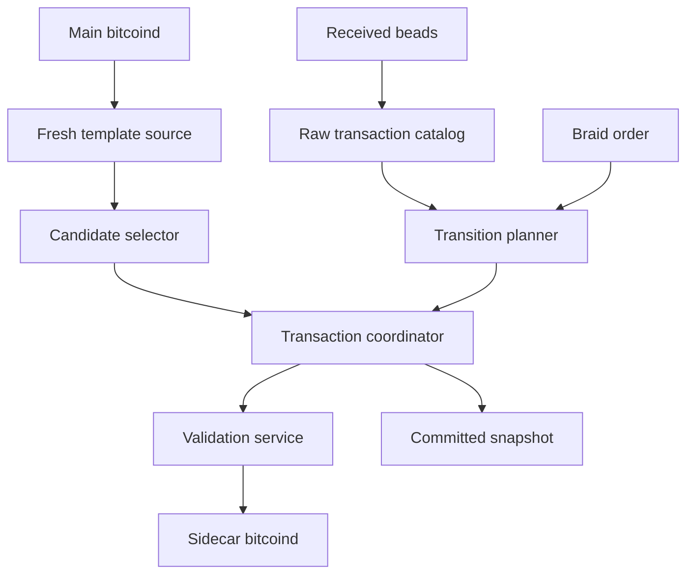
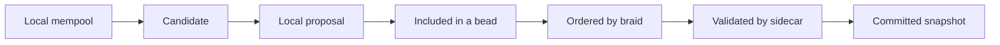
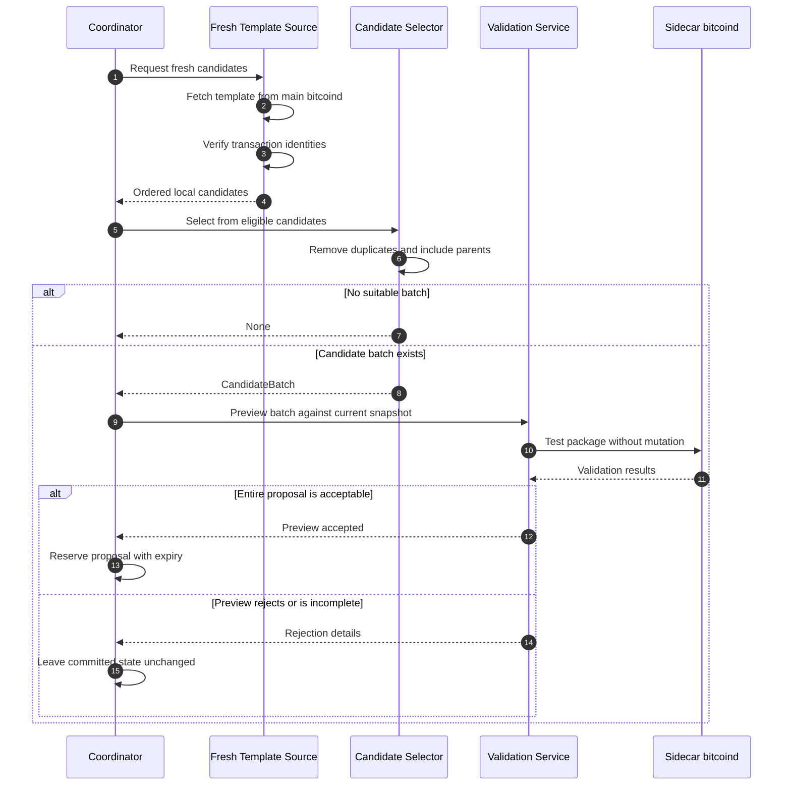
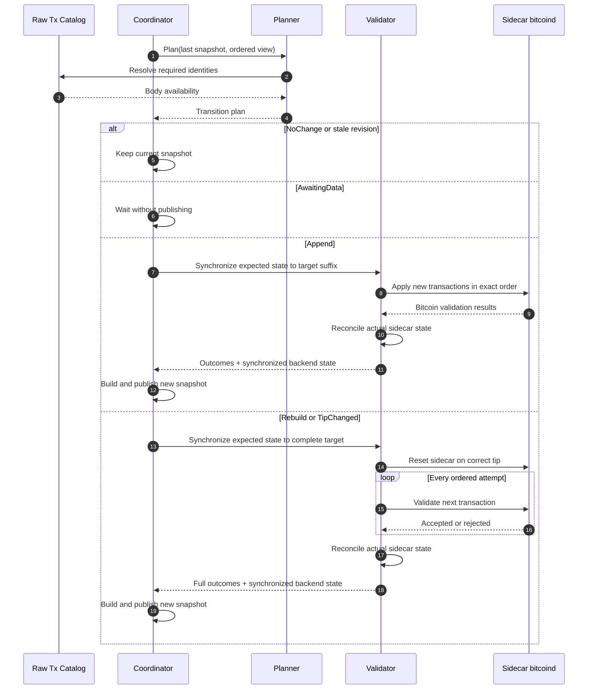
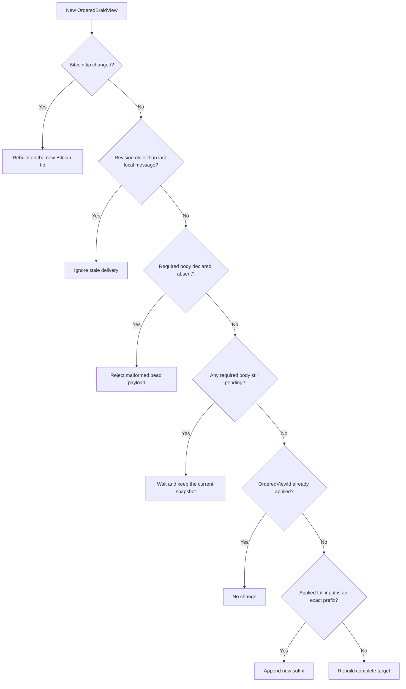
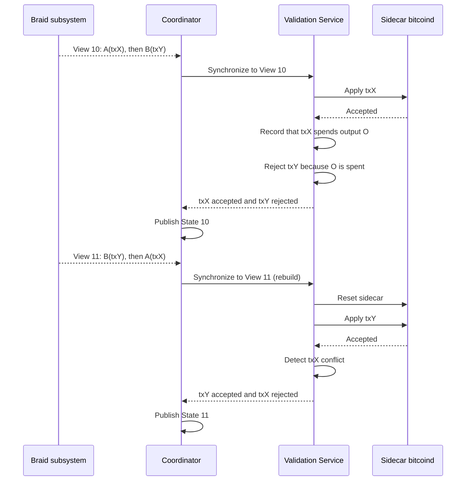
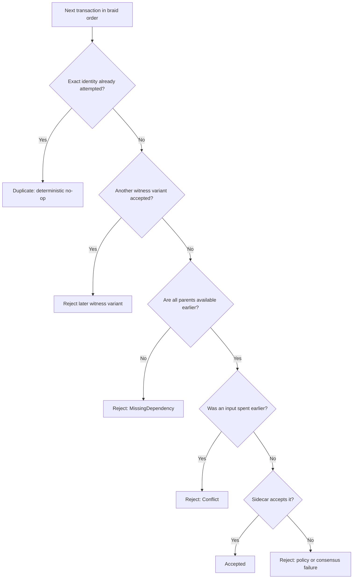
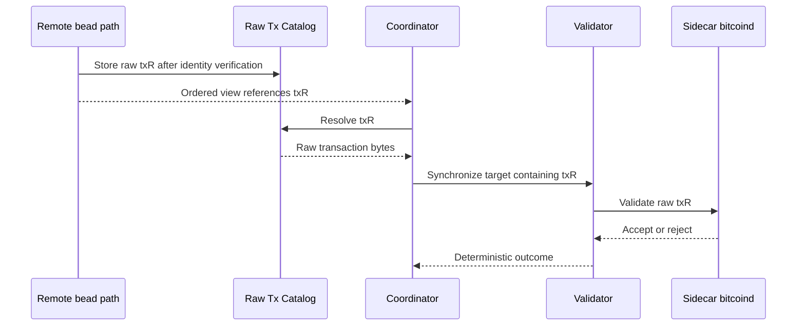
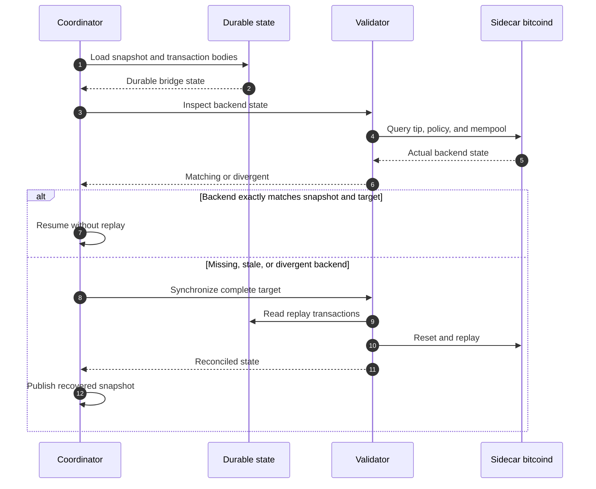
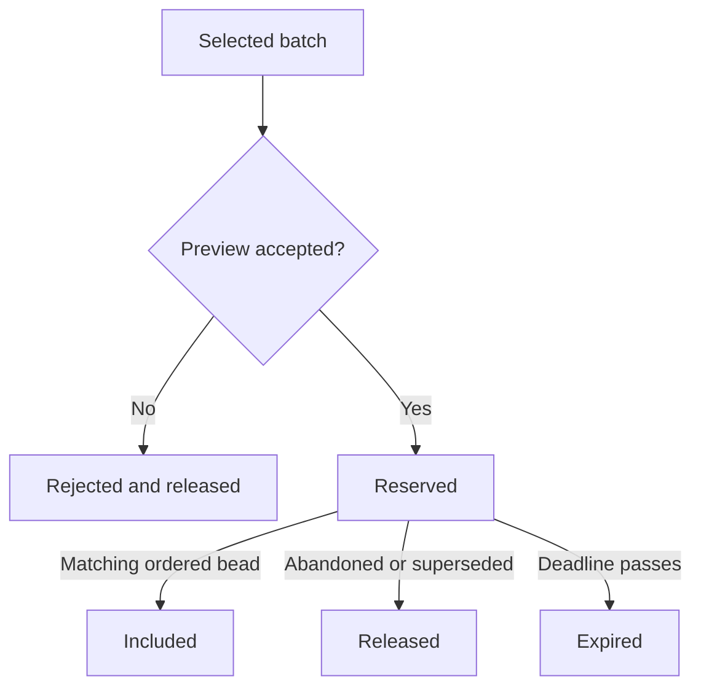

# Braidpool Transaction Bridge Protocol

## 1. Scope and boundaries

### The bridge is responsible for

1. Reading fresh candidate transactions from the main `bitcoind`.
2. Selecting a dependency-safe batch of 2–5 transactions for a local proposal.
3. Receiving the deterministic ordered view produced by the braid subsystem.
4. Resolving ordered transaction identities to verified raw bytes.
5. Validating and synchronizing committed state through an isolated sidecar
   `bitcoind`.
6. Publishing a deterministic `CommittedPoolSnapshot`.
7. Recovering after restart, reorder, missing data, or Bitcoin tip change.

---

## 3. High-level design

### 3.1 System placement

This diagram answers: **where does the bridge sit, and which component owns each
step?** Solid arrows show the main direction of data or control. Response values
are omitted here and shown in the sequence diagrams later.



The upper path creates local proposals. The middle path derives the target
order. The lower bridge components validate that target and publish its state.
The coordinator is where the paths meet.

### 3.2 Control and data paths

This diagram answers: **when does a local transaction become committed?**



The first two steps are local and speculative. A proposal can reach committed
state only after bead inclusion, braid ordering, and validation.

---

## 4. Module roles and positioning

| Module | Position | Receives | Produces | Owns | Must not do |
|---|---|---|---|---|---|
| **Fresh Template Source** | Adapter beside main `bitcoind` | Request for candidates | One fresh, verified transaction list | Candidate acquisition | Cache templates across attempts or mutate committed state |
| **Candidate Selector** | Pure helper called by the coordinator | Candidates, committed IDs, reservations, limits | Dependency-closed batch of 2–5 | Local filtering and package ordering | Perform braid ordering or commit state |
| **Raw Tx Catalog** | Durable boundary between bead input and replay | Identity plus raw bytes | Verified raw transaction | Restart-safe transaction bodies | Decide order or validity in current state |
| **Braid subsystem** | Existing consensus/order layer | Connected beads and work | `OrderedBraidView` | Deterministic bead order | Perform Bitcoin transaction validation |
| **Transition Planner** | Pure logic inside bridge | Last applied snapshot and new ordered view | Transition action | Detect no-op, wait, append, rebuild, tip change | Mutate sidecar or decide Bitcoin validity |
| **Transaction Coordinator** | Central bridge actor | Candidate batches, ordered views, validator results | Reservations and committed snapshots | Proposal lifecycle and the single logical write path | Reimplement braid order or Bitcoin validation |
| **Validation Service** | Backend abstraction below coordinator | Preview or target-state synchronization request | Deterministic outcomes and backend state | Sidecar orchestration and reconciliation | Select candidates or publish committed state |
| **Sidecar `bitcoind`** | Isolated external validator | Standard Bitcoin RPC calls | Policy/consensus accept or reject result | Concrete committed mempool | Understand beads, braid work, or proposal policy |

### Why the coordinator is the single writer

Candidate refreshes, remote bead arrivals, reorder notifications, and tip changes
can happen concurrently. If each path updates transaction state independently,
nodes can publish a snapshot that never existed in one complete ordered view.

All events therefore pass through one coordinator actor:

1. Local candidate, ordered-view, body-available, tip-change, and recovery
   events enter the coordinator mailbox.
2. The coordinator handles one state transition at a time.
3. It publishes a new snapshot only after the entire transition succeeds.

---

## 5. Core data model

```rust
struct TransactionIdentity {
    txid: Txid,
    wtxid: Wtxid,
}

struct RawTransaction {
    identity: TransactionIdentity,
    bytes: Vec<u8>, // decoded and verified against txid + wtxid
}

enum BodyAvailability {
    Present(RawTransaction),
    Pending,
    Absent,
}

struct CandidateBatch {
    transactions: Vec<RawTransaction>, // 2–5, dependency ordered
}

struct OrderedBeadBatch {
    bead_hash: BeadHash,
    transactions: Vec<TransactionIdentity>,
}

struct OrderedBraidView {
    bitcoin_tip: BlockHash,
    revision: u64,
    view_id: OrderedViewId,
    batches: Vec<OrderedBeadBatch>,
}

struct CommittedPoolSnapshot {
    bitcoin_tip: BlockHash,
    policy_profile: PolicyProfile,
    policy_id: PolicyId,
    order_revision: u64,
    applied_view_id: OrderedViewId,
    accepted_transactions: Vec<TransactionIdentity>,
    outcome_digest: OutcomeDigest,
    state_id: StateId,
}
```

### Identity rules

- `txid` identifies the non-witness transaction.
- `wtxid` distinguishes different witness serializations of the same `txid`.
- Raw bytes are decoded and checked against both before entering the catalog.
- An exact duplicate is the same `txid` and `wtxid`.
- Same `txid` with a different `wtxid` remains a separate ordered attempt.
  At most one variant for a `txid` may be accepted.

### Hash roles

| Hash | Contains | Purpose |
|---|---|---|
| `OrderedViewId` | Bitcoin tip, ordered bead hashes, exact transaction identities | Consensus-relevant identity of the ordered input |
| `PolicyId` | Checked and versioned sidecar policy profile | Prevent comparison across different validation policies |
| `OutcomeDigest` | Ordered accepted/rejected outcomes and reasons | Ensure rejected attempts affect derived-state identity |
| `StateId` | Version, tip, policy, ordered view, accepted set, outcome digest | Compare complete committed states across nodes |

`revision` is only a local stale-message guard. It is not part of consensus and
must not replace `OrderedViewId`.

---

## 6. Behavior A: create a local proposal

Local selection is speculative. Nothing becomes committed in this flow.

This sequence answers: **how is a local proposal built and previewed?**



### Selection behavior

- Request a fresh template for every attempt.
- Exclude transactions already committed, already reserved, or repeated.
- Preserve dependency order: parent before child.
- Include missing uncommitted parents in the same batch.
- Return `None` when fewer than two eligible transactions remain or a required
  dependency closure exceeds the five-transaction limit.
- Release a reservation when its proposal is included, abandoned, superseded,
  or expired.

Preview answers “could this batch be proposed against the current snapshot?” It
does not answer “is this batch now committed?”

---

## 7. Behavior B: apply an ordered braid view

This is the only normal flow that changes committed state.

This sequence answers: **how does a new braid order become one committed
snapshot?**

Before the sequence begins, bead ingestion verifies and stores transaction
bodies in the catalog, then sends the ordered view to the coordinator.



### Planner decision tree

This diagram answers: **does a new ordered view require waiting, appending, or
rebuilding?**



The prefix comparison uses the complete ordered input, including attempts that
were rejected. Comparing only accepted transactions can misclassify a reorder
and retry a rejected suffix forever.

---

## 8. Behavior C: reorder or conflict

Suppose two sibling beads propose transactions spending the same output:

```text
Bead A -> txX spends output O
Bead B -> txY spends output O
```

The braid decides order. The bridge applies that order without using fee or
arrival time as a tie breaker.

This sequence answers: **what happens when the braid reverses two conflicting
transactions?**



Conflict detection occurs before mutating the sidecar. Otherwise Bitcoin Core's
replacement policy could allow a later, higher-fee transaction to evict the
earlier protocol winner.

---

## 9. Behavior D: duplicates, dependencies, and unknown transactions

### Ordered-attempt rules

This diagram answers: **how is each transaction classified during replay?**



### Unknown remote transaction

The main `bitcoind` does not need to know a transaction received in a bead.

This sequence answers: **how can the bridge validate a transaction that exists
only in a remote bead?**



The main `bitcoind` does not participate in this sequence. The sidecar validates
`txR` directly from the cataloged bytes.

### Missing body semantics

| Availability | Meaning | Behavior |
|---|---|---|
| `Present` | Verified raw bytes are in the catalog | Continue planning and validation |
| `Pending` | Transport says a valid bead/body is still being assembled | Wait without changing the snapshot |
| `Absent` | A complete bead requires the identity but provides no resolvable body | Treat as malformed bead data |

`Pending` must not become an unlimited fallback for malformed complete beads.

---

## 10. Behavior E: restart and Bitcoin tip change

### Restart recovery

This sequence answers: **how does the bridge decide whether it can resume or
must replay after restart?**



Evidence needed for replay must be durable before the bridge claims restart
safety. Txids alone are insufficient because a remote body may no longer be
available.

### Bitcoin tip change

A new tip changes the UTXO view and can invalidate previously accepted
transactions. The coordinator must stop appending to the old state, obtain the
new ordered view for the new tip, and rebuild or otherwise synchronize the
sidecar against that tip. It must never combine a snapshot from one tip with a
sidecar on another.

---

## 11. Validation Service contract

The coordinator requests a target state; it does not control sidecar reset
details.

```rust
#[async_trait]
trait TransactionValidator {
    async fn preview(
        &self,
        base: &CommittedPoolSnapshot,
        package: &[RawTransaction],
    ) -> Result<PreviewResult, ValidationError>;

    async fn synchronize(
        &mut self,
        expected: &CommittedPoolSnapshot,
        target: &TargetCommittedState,
    ) -> Result<SynchronizationResult, ValidationError>;

    async fn inspect_state(&self) -> Result<BackendState, ValidationError>;
}
```

### Backend behavior

- `preview` is non-mutating and uses the current committed context.
- `synchronize` chooses no-op, append, or reset/replay internally.
- Every mutation is followed by reconciliation against the expected txids,
  Bitcoin tip, and policy.
- A partial package acceptance is recorded per ordered transaction; it is never
  reported as whole-package success.
- Relay from the sidecar is disabled so validation does not leak or alter normal
  Bitcoin P2P behavior.

### Bitcoin Core constraints

- `testmempoolaccept` is non-mutating but package order and partial evaluation
  matter.
- `submitpackage` is experimental and supports restricted package shapes.
- `sendrawtransaction` mutates the mempool and may relay unless the sidecar is
  isolated.
- Bitcoin Core policy is versioned and configurable; all nodes must use the
  checked profile represented by `PolicyId`.
- There is no general registered “clear mempool” RPC. Reset/replay therefore
  needs an explicit backend strategy such as controlled sidecar recreation.

The exact RPC sequence is an adapter detail. Its observable result must satisfy
the protocol contract above.

---

## 12. State transitions

### 12.1 Local proposal lifecycle

Only a successful preview creates a reservation. Every terminal path releases
the proposal from the active reservation set.



### 12.2 Committed-state synchronization

The coordinator publishes a snapshot only from the synchronized state.

| Current state | Event | Next state | Publish a snapshot? |
|---|---|---|---|
| Recovering | Backend matches, or replay and reconciliation succeed | Synchronized | Yes |
| Recovering | Backend unavailable | Degraded | No |
| Synchronized | No-op or append succeeds and reconciles | Synchronized | Yes |
| Synchronized | Required transaction body is pending | Awaiting data | No |
| Synchronized | Order or Bitcoin tip changes | Rebuilding | No |
| Awaiting data | Body arrives and synchronization succeeds | Synchronized | Yes |
| Awaiting data | Integrity failure | Degraded | No |
| Rebuilding | Replay and reconciliation succeed | Synchronized | Yes |
| Rebuilding | Reset or replay fails | Degraded | No |
| Degraded | Retry or operator recovery begins | Recovering | No |

No transition publishes a partially synchronized snapshot.

---

## 13. Failure behavior

| Situation | Required behavior | Committed snapshot |
|---|---|---|
| No eligible local batch | Return no proposal | Unchanged |
| Local preview rejects | Release candidate/reservation | Unchanged |
| Duplicate ordered view | No-op | Unchanged |
| Older local revision | Ignore delivery | Unchanged |
| Required body pending | Wait and retry when body arrives | Unchanged |
| Body absent from a complete bead | Reject malformed payload upstream | Unchanged |
| Missing dependency | Record deterministic rejection | New snapshot may record the outcome |
| Double spend | Earlier ordered accepted transaction wins | New snapshot records conflict outcome |
| Sidecar RPC unavailable | Enter degraded/retry state; do not guess | Unchanged |
| Partial sidecar mutation | Reconcile, then rebuild if needed | Unchanged until synchronized |
| Ordered view changes prefix | Reset/replay complete target | Replaced only after reconciliation |
| Bitcoin tip changes | Stop old-tip writes and recover on new tip | Retained only as stale old-tip state until replacement |
| Restart with divergent sidecar | Rebuild from catalog and ordered view | Published after successful recovery |

Errors and metrics may contain identities, counts, state IDs, and reason codes.
They should not contain unbounded raw transaction bytes or RPC credentials.

---

## 14. Protocol invariants

1. The main Bitcoin mempool never directly changes committed state.
2. Only the ordered braid view can introduce a normal committed-state change.
3. The braid owns order; the coordinator consumes it.
4. The coordinator is the single logical writer of reservations and snapshots.
5. Raw bytes are verified against both `txid` and `wtxid` before cataloging.
6. Local proposals contain 2–5 transactions and are dependency closed.
7. Exact duplicate attempts collapse at their first occurrence.
8. The first valid transaction in braid order wins a double-spend conflict.
9. Sidecar policy and Bitcoin tip are part of state identity.
10. Rejected ordered attempts affect the outcome digest.
11. A snapshot is published only after backend reconciliation succeeds.
12. Missing data, RPC failure, or partial replay never produces partial committed
    state.
13. Given the same tip, policy, verified raw bodies, and ordered view, honest
    nodes derive the same `StateId`.

---

